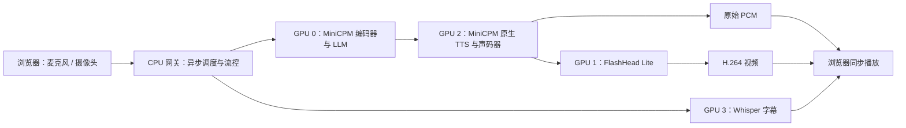

# DuplexAvatar

**能看、能听、能被打断的实时数字人。**

MiniCPM-o 4.5 接收麦克风和摄像头输入，生成文字及原声音频；SoulX-FlashHead Lite 用同一段音频生成数字人视频。支持仅音频输入、倾听动画、自然打断过渡，以及四张 GPU 上的异步流水线。

Real-time full-duplex audiovisual avatar: MiniCPM-o 4.5 → original speech → SoulX-FlashHead Lite.

## 演示

| 输入方式 | 演示录像 |
| --- | --- |
| 摄像头 + 麦克风 | [观看带视觉输入的 Demo](https://www.awesomescreenshot.com/video/57484530) |
| 仅麦克风 | [观看不带视觉输入的 Demo](https://www.awesomescreenshot.com/video/57479237?key=d00b75db8a81288f235ebb684174c444) |

两段录像为项目实际操作演示，托管在 Awesome Screenshot。

## 已实现

- **实时双向交互**：持续接收用户输入，同时播放回复；支持语音插话和手动打断。
- **保留 MiniCPM 原声**：原始 24 kHz PCM 独立传送，A2V 只生成画面。
- **输入与输出独立选择**：仅音频 / 音频 + 摄像头；数字人 + 原声 / 仅原声。
- **5 FPS 视觉输入**：每 200 ms 独立采样，按时间顺序批量送入 MiniCPM；显示服务端实际处理的画面与帧数。
- **持续倾听动作**：静音驱动 A2V；打断时按屏幕正在播放的姿态接续，句尾补齐无声画面。
- **输入反馈**：麦克风响度、已收到的音频时长、用户 ASR 字幕、输入 / 回复时间戳。
- **并行与加速**：理解、原声生成、数字人、字幕分配到四张 GPU；`torch.compile`、有界队列、流量控制、H.264 / WebCodecs。

当前已接入并验证的 A2V 后端是 **FlashHead Lite**。FlashHead Pro、FlashTalk、LiveAvatar 尚未接入本项目界面。当前服务支持一个活动会话。

## 四卡架构



| 模块 | 默认物理 GPU | 进程 / 环境 |
| --- | --- | --- |
| 音频 / 视觉编码、LLM 理解与决策 | 0 | brain / MiniCPM 环境 |
| 同一 MiniCPM 的原生 TTS、声码器 | 2 | brain 内有序语音线程 / MiniCPM 环境 |
| FlashHead Lite 视频生成 | 1 | avatar / FlashHead 环境 |
| faster-whisper-large-v3 字幕 | 3 | asr / 独立字幕环境 |
| HTTPS、WebSocket、媒体调度 | CPU | gateway / MiniCPM 环境 |

这是**单机四卡的组件分工与流水线并行**。理解和语音使用同一进程内的两个 CUDA 设备；数字人与字幕是独立进程。下一块输入可以与上一块语音 / 视频生成重叠执行。当前不支持跨机器部署、LLM 张量并行或四个并发会话。

## 硬件与显存

验证平台：Linux x86_64、Python 3.10.20、NVIDIA H200 × 4，驱动 570.124.06。安装脚本使用 CUDA 12.8 的 PyTorch 包和匹配的 FlashAttention wheel。需要可用的 `git`、`ffmpeg`、`openssl`、C/C++ 编译器与 NVIDIA 驱动；安装脚本不修改系统驱动。

**逐卡峰值、同时总占用、测试条件与容量建议见 [显存实测](docs/performance.md#显存)。** 显存按每张卡分别判断；四卡总容量不能补偿理解卡上的不足。启动预热也要留出空间，不能只看对话开始后的占用。

本轮采样峰值：**理解 22.00 GiB / 原声 7.33 GiB / 视频 6.21 GiB / 字幕 3.83 GiB；四卡同时最高 39.37 GiB**。这是 H200 上特定工作负载的观察值，实际采样间隔中位数 1.404 秒；短暂峰值可能未捕获，不应当作最低显存保证。

环境与模型分开存储，建议准备至少 100 GB 可用磁盘及 64 GB 主机内存；这是部署余量建议，不是已测最低要求。当前没有完成消费级 GPU 或量化版本的整链路验证。

## 从零部署

以下命令在 Linux 服务器执行。三个上游项目会自动放到 DuplexAvatar 的同级目录，不需要预先部署其他项目。

### 1. 获取项目与安装工具

```bash
mkdir -p ~/duplex-workspace
cd ~/duplex-workspace
git clone https://github.com/zzzweakman/DuplexAvatar.git
cd DuplexAvatar

python3 -m pip install --user uv
export PATH="$HOME/.local/bin:$PATH"
```

系统依赖可通过系统包管理器安装，例如 Ubuntu / Debian 的 `git ffmpeg openssl build-essential libsndfile1 libgl1 libglib2.0-0`。已经具备这些命令和库时可跳过。

### 2. 选择 GPU

仓库默认使用 **0、1、2、3**：GPU 0 负责理解，GPU 2 负责原声，GPU 1 负责视频，GPU 3 负责字幕。普通四卡机器可直接使用，无需设置额外环境变量。

如果需要使用开发服务器原来的 **4、5、6、7** 分配，在当前终端执行：

```bash
export DUPLEX_AVATAR_CONFIG=deploy/four-gpu-4-7.json
```

自定义分配可创建被 Git 忽略的 `config.local.json`，写入以下字段，然后设置 `DUPLEX_AVATAR_CONFIG=config.local.json`：

```json
{
  "allowed_gpus": [0, 1, 2, 3],
  "brain_gpu": 0,
  "tts_gpu": 2,
  "avatar_gpu": 1,
  "asr_gpu": 3
}
```

数字是**物理 GPU 编号**。启动器为每个进程设置 `CUDA_VISIBLE_DEVICES`；brain 进程中理解为 `cuda:0`，原声为 `cuda:1`。使用自定义分配时，更换终端后要重新设置配置文件环境变量；恢复仓库默认值时取消 `DUPLEX_AVATAR_CONFIG` 和 `DUPLEX_AVATAR_OVERRIDES`。不要把进程内的逻辑设备编号填成物理编号。

### 3. 安装代码、环境、权重与证书

```bash
python3 scripts/setup.py all
```

脚本依次执行：

1. 克隆三个上游并固定到 [sources.json](deploy/sources.json) 中已验证的提交；已有目录版本不符时停止，不改写已有 checkout。
2. 使用 `uv` 创建三个 Python 3.10 环境，安装固定版本依赖。`uv` 可自动获取 Python；也可传入 `--python /path/to/python3.10`。
3. 下载固定 revision 的 MiniCPM-o 4.5、FlashHead Lite / VAE、wav2vec2 和 Whisper。无需下载 Gander 主模型或 FlashHead Pro。
4. 在 `runtime/certs/` 生成 localhost HTTPS 证书，并安装随仓库提供的合成测试语音。
5. 检查环境路径、模型文件、证书和 GPU 配置。

如某一步失败，可单独重跑该步骤：

```bash
python3 scripts/setup.py sources
python3 scripts/setup.py envs
python3 scripts/setup.py models
python3 scripts/setup.py tls
python3 scripts/setup.py fixtures
python3 scripts/setup.py doctor
```

下载需要访问 GitHub、PyPI、PyTorch 与 Hugging Face。权重不包含在此仓库内。完整环境版本保存在 `deploy/requirements-*.txt`；请保留三个隔离环境，不要混装 torch / transformers。

| 环境 | PyTorch | Transformers | 其他关键版本 |
| --- | --- | --- | --- |
| MiniCPM / 网关 | 2.8.0 + CUDA 12.8 | 4.51.0 | minicpmo-utils 1.0.6、librosa 0.11.0 |
| FlashHead | 2.7.1 + CUDA 12.8 | 4.57.3 | diffusers 0.39.0、xformers 0.0.31、FlashAttention 2.8.0.post2 |
| 字幕 | 2.6.0 + CUDA 12.4 | 4.51.0 | faster-whisper 1.2.1、CTranslate2 4.8.3 |

这三个环境快照的安装依赖均已通过独立解析检查；当前真实链路验收复用了已安装环境，尚未在另一台空白服务器完成从下载到推理的全流程复现。

```text
duplex-workspace/
├── DuplexAvatar/                 # 本仓库
├── MiniCPM-o-Demo/
│   ├── .venv/base/
│   └── models/MiniCPM-o-4_5/
├── SoulX-FlashHead/
│   ├── .venv/
│   └── models/{SoulX-FlashHead-1_3B,wav2vec2-base-960h}/
└── Omni-Interaction-Agent/
    ├── .venv/
    └── checkpoints/faster-whisper-large-v3/
```

### 4. 启动

```bash
python3 scripts/manage.py start
```

等待终端出现 `READY https://localhost:8443`。第一次编译与预热需要数分钟；启动器最多等待 30 分钟。下载权重、编译以及运行时缓存都不应在首次用户会话中进行。

```bash
python3 scripts/manage.py status
curl -k https://127.0.0.1:8443/health
```

`status` 检查记录的进程是否仍存活；`/health` 显示各模块就绪状态。日志位于 `runtime/run-*/`，`status` 会给出当前各进程日志路径。

### 5. 打开界面

服务器本机访问 **https://localhost:8443**。远程服务器推荐 SSH 转发，在自己的电脑执行：

```bash
ssh -N -L 8443:127.0.0.1:8443 user@your-server
```

也可通过 VS Code Remote SSH 的 Ports 面板转发 8443，协议选择 HTTPS。浏览器打开 localhost 地址，接受本地自签名证书，允许麦克风 / 摄像头。

推荐桌面 Chrome 或 Edge。点击「运行音视频样例」检查链路；实际对话选择输入模式及是否生成数字人，再点击「开始对话」。切换模式先结束当前会话。仅音频输入不会申请摄像头权限。

服务默认绑定 `127.0.0.1`；内部端口为 22610 / 22611 / 22612，浏览器入口为 8443。当前没有面向公网的账号与多租户隔离；需要公网访问时，在入口配置身份验证和可信 HTTPS 反向代理。

### 6. 停止与重载

```bash
python3 scripts/manage.py stop
python3 scripts/manage.py status
```

`stop` 向本项目记录且身份匹配的进程组发送 SIGTERM。等待模型进程退出后再次运行 `status`，所有 `alive` 应为 `false`。GPU 内存随进程退出释放。

没有活动会话时可独立重载：

```bash
python3 scripts/manage.py restart-gateway
python3 scripts/manage.py restart-brain
python3 scripts/manage.py restart-avatar
python3 scripts/manage.py restart-asr
```

修改端口或 GPU 分配后，请完整停止并重新启动。不要用后台启动命令反复叠加模型进程。

## 加速与调度

默认已经启用经过验证的加速配置：

| 配置 | 默认值 | 作用 |
| --- | --- | --- |
| `compile_brain` | `true` | 编译 MiniCPM 的 LLM / TTS Transformer |
| `compile_avatar` | `true` | 编译 FlashHead DiT 与 VAE |
| `compile_vocoder` | `false` | 实验中没有获得收益，保持关闭 |
| `vision_input_fps` | `5` | 摄像头独立 200 ms 采样 |
| `vision_context_units` | `24` | 视觉会话保留最近 24 个输入单元 |
| `vision_previous_tokens` | `500` | 保留窗口外旧回复文本的 token 上限 |
| `speech_postroll_ms` | `480` | 句尾至少保留的静音驱动画面，向完整 A2V 块取整 |
| `input_buffer_seconds` | `30` | 输入积压的保护上限；不增加模型处理能力 |

编译缓存位于 `runtime/cache/inductor` 和 `runtime/cache/triton`。启动时预热纯音频、1 / 4 / 5 / 6 帧视觉输入、960 / 1000 ms 时钟及上下文淘汰，减少真实会话中重新编译的停顿。更换 GPU、PyTorch 或模型版本后可能需要重新编译。

数字人模式统一使用 **24 帧 ÷ 25 FPS = 960 ms** 的块时钟：输入 16 kHz × 960 ms = 15,360 个采样，A2V 驱动 24 kHz × 960 ms = 23,040 个采样。MiniCPM 原声通过无损缓冲重新分块；纯音频输出使用 1,000 ms 输入单元。打断不等待一个块播放结束。

控制与媒体使用独立 WebSocket。输入确认窗口按 RTT 在 2–8 块间调整，视频解码确认窗口为 2–6 块；说话优先于可丢弃的倾听动作。WebCodecs 可用时传输独立 H.264 块，否则回退 JPEG。媒体队列和运动历史都有上限。

视觉上下文窗口限制了原始画面 / 音频的历史范围：数字人模式约最近 23 秒，并保留部分旧回复文本。这是避免长时间视觉会话输入越积越慢的取舍；仅音频会话恢复模型原有窗口设置。

编译与四卡实测对照、测量口径及显存见 [性能说明](docs/performance.md)。FlashHead Lite 双卡切分在本机实测更慢，正式服务将它放在一张卡上。

## 验证部署

```bash
# 无 GPU 推理的逻辑测试
../MiniCPM-o-Demo/.venv/base/bin/python -m unittest discover -s tests -v

# 服务就绪后：实际模型、原声一致性及视频输出
../MiniCPM-o-Demo/.venv/base/bin/python scripts/smoke.py
../MiniCPM-o-Demo/.venv/base/bin/python scripts/smoke.py --audio-input
../MiniCPM-o-Demo/.venv/base/bin/python scripts/smoke.py --audio-input --audio-output
```

测试应逐个执行，期间不要在网页开启其他会话。测试结果与生成视频保存在被 Git 忽略的 `runtime/`。浏览器、5 FPS 摄像头、打断与显存复测步骤见 [测试指南](docs/testing.md)。

## 常见问题

| 现象 | 检查与处理 |
| --- | --- |
| `No recorded run` | 尚未执行过 `manage.py start`；先安装，再启动 |
| `authorized physical GPUs` | 配置中的分工不在 `allowed_gpus` 内；默认允许 0–3，自定义分配需同步修改允许列表 |
| `librosa` 版本冲突 | 使用本仓库安装脚本；MiniCPM 的 0.11.0 覆盖项是有意设置 |
| NCCL / FlashAttention ABI 错误 | 保持 FlashHead 的 torch 2.7.1+cu128、NCCL 2.26.2 和 CPython 3.10 对应 wheel |
| ASR 报找不到 cuBLAS / cuDNN | 使用 `manage.py` 启动；它设置字幕环境内 NVIDIA 库的搜索路径 |
| 启动长时间 loading | 查看 brain / avatar 日志是否正在编译预热；服务全部 ready 后再进入会话 |
| 浏览器没有麦克风 / 摄像头 | 使用 HTTPS localhost 转发、接受证书并检查站点权限；仅音频模式不需要摄像头 |
| 能预览摄像头但回答不符 | 检查「运行信息」的模型已处理帧数 / 最近画面；仅有本地预览不表示模型收到了图像 |
| 输入缓冲增长 | 检查处理耗时、上传等待和网络 RTT；确认编译、视觉窗口及 H.264 生效，避免只调大缓存 |
| 句尾没说完 / 打断残留 | 刷新前端并重载所有服务，确保音频与视频使用同一版本；查看 `voice_reset` / `tts_generation` 日志 |
| CUDA OOM | 先核对逐卡峰值和同卡其他进程；缩短视觉上下文或关闭编译后重新测试，不能假定降级后仍满足实时要求 |

## 代码导航

- `duplex_avatar/brain_server.py`：MiniCPM 适配、视觉输入与预热。
- `duplex_avatar/parallel_voice.py` / `parallel_session.py`：分卡原声与异步会话。
- `duplex_avatar/avatar_server.py`：FlashHead 流式推理与运动状态。
- `duplex_avatar/gateway.py` / `transport.py`：会话、队列、打断与媒体传送。
- `frontend/`：免构建的浏览器界面、采集和同步播放。
- `scripts/`：部署管理、验证与性能基准。
- `deploy/`：固定依赖、上游版本与 GPU 配置示例。

## 致谢与许可

DuplexAvatar 自有集成代码采用 [Apache-2.0](LICENSE) 许可证。

感谢 [MiniCPM-o / OpenBMB](https://github.com/OpenBMB/MiniCPM-o)、[MiniCPM-o-Demo](https://github.com/OpenBMB/MiniCPM-o-Demo)、[SoulX-FlashHead](https://github.com/Soul-AILab/SoulX-FlashHead)、[Omni-Interaction-Agent](https://github.com/Omni-Interaction-Gander/Omni-Interaction-Agent) 和 [faster-whisper](https://github.com/SYSTRAN/faster-whisper)。模型、参考音色、示例头像与字体遵循各自上游许可，参见 [第三方说明](THIRD_PARTY_NOTICES.md)。
